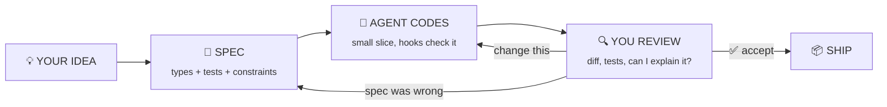
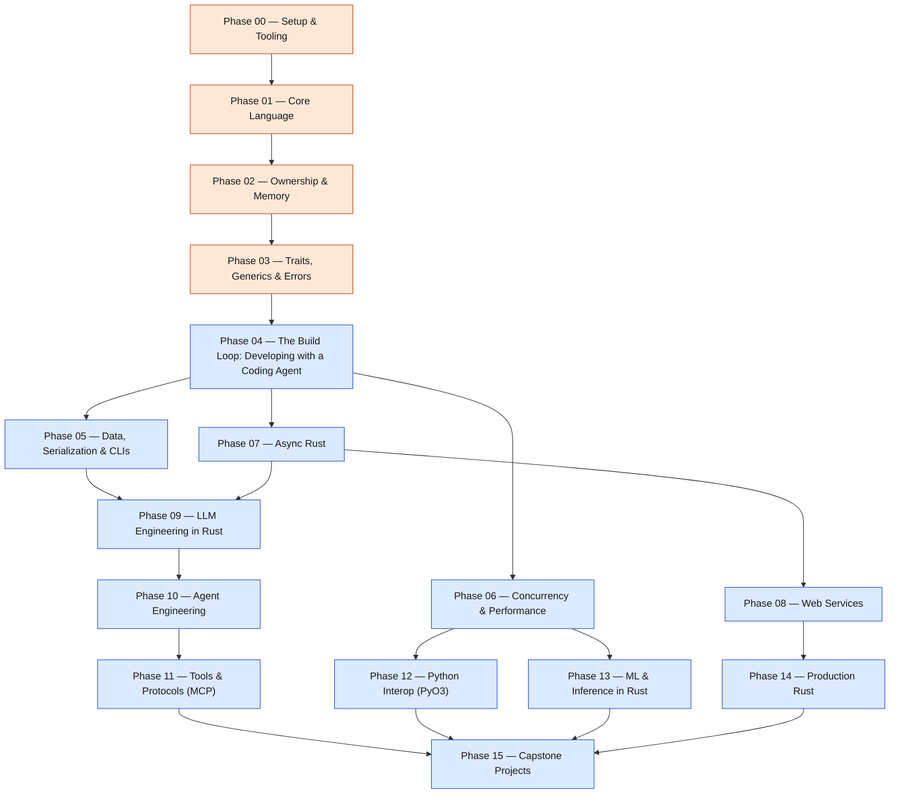
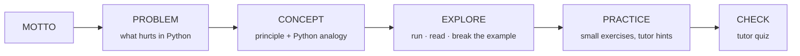
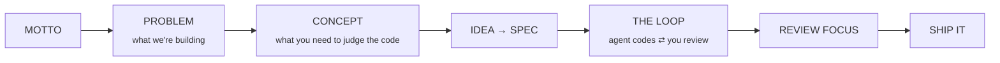

# 🦀 Rust for AI Engineers — From Scratch

**Learn the language with a tutor. Build with an agent. Stay in control.**

A Rust curriculum for engineers who already ship AI in Python and want the systems layer of
the agent era: fast tool servers, agent runtimes, MCP servers, inference, and
Rust-accelerated Python libraries. Built for how code gets written now: **you understand the
language deeply, and a coding agent does most of the typing, under your control.**

`16 phases` · `120 lessons` · `~266 hours` · `MIT`

> Python stays your orchestration language. Rust becomes the layer underneath it:
> the part that has to be fast, correct, concurrent and safe to run unattended.

---

## How this course works: two parts

| | Part 1 · Learn Rust | Part 2 · Build with a coding agent |
|---|---|---|
| **Phases** | 00–03 · 31 lessons · ~52 h | 04–15 · 89 lessons · ~214 h |
| **Goal** | The language, its principles and its mindset: ownership, borrowing, types, traits, errors | Develop real things in Rust: CLIs, services, agents, MCP servers, PyO3 packages, inference |
| **Your agent is** | Your **tutor**: explains, answers "why", quizzes you, reviews your attempts | Your **developer**: writes the code from your spec |
| **You** | Read, run, break and play with examples until you can explain them | Bring the idea, write the spec, review every diff, decide what ships |

Part 2 is one loop, repeated at every scale, and **you control every arrow**:



Rust is unusually good for this loop. The compiler and clippy check the agent's code seconds
after each edit, types make your spec precise, and risky shortcuts (`unwrap`, `clone`,
`unsafe`, `#[allow]`) show up in every diff. Part 1 is what lets you review that code with
confidence; Phase 04 turns the loop into a habit.

## Start here: choose what you want to build

Everyone does **Part 1 (Phases 00–03)** and **Phase 04 (the build loop)**. Then pick a route:

| Your goal | Route after Phase 04 |
|---|---|
| Everything, in order | Phases 05 → … → 15 |
| Agents and MCP servers in Rust | [Phase 07](phases/07-async-rust/README.md) → 09 → 10 → 11 → 15 |
| Speed up existing Python AI code | [Phase 06](phases/06-concurrency-and-performance/README.md) → 12 → 15 |
| Run models locally / inference | [Phase 06](phases/06-concurrency-and-performance/README.md) → 13 → 15 |
| Production backend for AI products | [Phase 07](phases/07-async-rust/README.md) → 08 → 14 → 15 |

## How to use each lesson

**Part 1 · Learn Rust**
1. **Read** the Problem and Concept. Ask your tutor until you could explain it to a Python colleague.
2. **Explore** the example in `code/`: `cargo run -p <package>`, change it, break it, read the compiler error.
3. **Practice** the small exercises. Try first; ask for a hint before a solution; have the tutor review.
4. **Check** with the tutor's quiz. Anything you miss goes to the review queue in `LEARNING.md`.

**Part 2 · Build with a coding agent**
1. **Learn the Concept** with your tutor: the Rust ideas you'll need to judge the code.
2. **Write your idea as a spec**: types, signatures, tests (one failure case at least), constraints.
3. **Run the loop** with `/build-loop`: the agent codes a small slice → hooks check it → you review → you decide.
4. **Ship it** when the tests pass *and* you can explain every line you're keeping. Log the loop in `LEARNING.md`.

## Clone it and produce your first evidence

```bash
git clone <your-fork-url> rust-ai-engineering-from-scratch
cd rust-ai-engineering-from-scratch
cargo run -p verify-env                           # Phase 00 · Lesson 01: checks your toolchain
cargo run -p ownership-and-move                   # Phase 02 · Lesson 01: the core Rust idea
cargo test -p reviewing-agent-rust -- --ignored   # Phase 04 · Lesson 05: agent code that's green but wrong
cargo run -p agent-loop                           # Phase 10 · Lesson 01: where you're heading
```

Fully written lessons so far:

- Phase 00 · [rustup, cargo & rust-analyzer](phases/00-setup-and-tooling/01-dev-environment/docs/en.md) — `cargo run -p verify-env`
- Phase 00 · [Cargo: build, run, test, workspaces](phases/00-setup-and-tooling/02-cargo-workflow/docs/en.md) — `cargo run -p cargo-workflow`
- Phase 00 · [clippy, rustfmt & reading compiler errors](phases/00-setup-and-tooling/03-clippy-and-fmt/docs/en.md) — `cargo run -p clippy-and-fmt`
- Phase 00 · [Unit, integration & doc tests](phases/00-setup-and-tooling/04-testing-basics/docs/en.md) — `cargo run -p testing-basics`
- Phase 00 · [Python → Rust mental map](phases/00-setup-and-tooling/05-python-to-rust-map/docs/en.md) — `cargo run -p python-to-rust-map`
- Phase 00 · [Learning Rust with an AI tutor](phases/00-setup-and-tooling/06-ai-as-tutor/docs/en.md)
- Phase 01 · [Variables, mutability & scalar types](phases/01-core-language/01-variables-and-types/docs/en.md) — `cargo run -p variables-and-types`
- Phase 01 · [Functions, expressions & control flow](phases/01-core-language/02-functions-and-control-flow/docs/en.md) — `cargo run -p functions-and-control-flow`
- Phase 01 · [Structs & methods (classes without inheritance)](phases/01-core-language/03-structs/docs/en.md) — `cargo run -p structs`
- Phase 01 · [Enums & pattern matching](phases/01-core-language/04-enums-and-match/docs/en.md) — `cargo run -p enums-and-match`
- Phase 01 · [Option & Result: no None surprises, no exceptions](phases/01-core-language/05-option-and-result/docs/en.md) — `cargo run -p option-and-result`
- Phase 01 · [Vec, HashMap, HashSet, VecDeque](phases/01-core-language/06-collections/docs/en.md) — `cargo run -p collections`
- Phase 01 · [String vs &str, UTF-8 & text processing](phases/01-core-language/07-strings/docs/en.md) — `cargo run -p strings`
- Phase 01 · [Modules, crates & visibility](phases/01-core-language/08-modules-and-crates/docs/en.md) — `cargo run -p modules-and-crates`
- Phase 01 · [Project: token & word statistics CLI](phases/01-core-language/09-project-word-stats/docs/en.md) — `cargo run -p project-word-stats`
- Phase 02 · [Ownership & move semantics](phases/02-ownership-and-memory/01-ownership-and-move/docs/en.md) — `cargo run -p ownership-and-move`
- Phase 04 · [The build loop: idea → agent code → review → repeat](phases/04-agentic-rust/01-the-build-loop/docs/en.md)
- Phase 04 · [Setting up a coding agent for a Rust repo (CLAUDE.md / AGENTS.md)](phases/04-agentic-rust/02-agent-setup/docs/en.md)
- Phase 04 · [Hooks: automatic fmt, clippy & tests after every agent edit](phases/04-agentic-rust/03-hooks-and-guardrails/docs/en.md)
- Phase 04 · [Reviewing agent-written Rust: the smells](phases/04-agentic-rust/05-reviewing-agent-rust/docs/en.md) — `cargo run -p reviewing-agent-rust`
- Phase 10 · [The agent loop](phases/10-agent-engineering/01-the-agent-loop/docs/en.md) — `cargo run -p agent-loop`

The other lessons are **outlines** with a fixed title, place and artifact; you write them as
you go (see [How this repo grows](#how-this-repo-grows)).

## The shape of the curriculum



🟧 Part 1 · Learn Rust (with your tutor) · 🟦 Part 2 · Build with a coding agent (your loop)

## The shape of a lesson

```
phases/<NN>-<phase>/<NN>-<lesson>/
├── code/        a Cargo crate (workspace member): cargo run -p <name>
├── docs/
│   └── en.md    the lesson
└── outputs/     what this lesson ships (prompt, skill, CLI, crate, MCP server…)
```

**Part 1 lessons**



**Part 2 lessons**



## Your agent setup (already in this repo)

| File | What it does |
|---|---|
| [`CLAUDE.md`](CLAUDE.md) (+ `AGENTS.md` symlink) | Tells any coding agent its role: tutor in Part 1, developer under your control in Part 2 |
| [`/learn-rust`](.claude/skills/learn-rust/SKILL.md) | Your tutor: placement, lessons, hints, reviews, quizzes, compiler-error explanations |
| [`/build-loop`](.claude/skills/build-loop/SKILL.md) | Runs Part 2's loop: idea → spec (you approve) → small slice → checks → your review → repeat |
| [`.claude/settings.json`](.claude/settings.json) + [hooks](.claude/hooks/post-edit-check.sh) | After every `.rs` edit: rustfmt + clippy `-D warnings`, errors fed back to the agent. Before it stops: tests must pass |
| [`rust-review` skill](phases/04-agentic-rust/05-reviewing-agent-rust/outputs/skill-rust-review.md) | A second reviewer for agent-written diffs (never the only one) |
| [Rust `CLAUDE.md` template](phases/04-agentic-rust/02-agent-setup/outputs/CLAUDE.md) | Copy into your own Rust projects |

**Tutor commands**

| Command | What it does |
|---|---|
| `/learn-rust start` | Placement questions, then a personal route in `LEARNING.md` |
| `/learn-rust` | Teaches the next lesson: warm-up, concept, explore, practice, quiz |
| `/learn-rust explain` | Paste a compiler error; learn the rule behind it |
| `/learn-rust quiz <phase>` | Eight-question phase check with lessons to review |
| `/learn-rust draft <lesson>` | Drafts an outline lesson with you |

**Build commands**

| Command | What it does |
|---|---|
| `/build-loop <your idea>` | Turns the idea into a spec with you, then loops: agent codes a slice, you review |
| `/build-loop review` | Walks you through the current diff with the review checklist before you decide |

## Contents

### Part 1 · Learn Rust

<details>
<summary><b>Phase 00 — Setup & Tooling</b> <code>6 lessons · ~6h</code></summary>

> A fast feedback loop is the first thing you build.

| # | Lesson | Type | Ships | Status |
|---|---|---|---|---|
| 01 | [rustup, cargo & rust-analyzer](phases/00-setup-and-tooling/01-dev-environment/docs/en.md) | Build | verify script | ✅ Complete |
| 02 | [Cargo: build, run, test, workspaces](phases/00-setup-and-tooling/02-cargo-workflow/docs/en.md) | Build | cargo cheat sheet | ✅ Complete |
| 03 | [clippy, rustfmt & reading compiler errors](phases/00-setup-and-tooling/03-clippy-and-fmt/docs/en.md) | Learn | prompt: explain-compiler-error | ✅ Complete |
| 04 | [Unit, integration & doc tests](phases/00-setup-and-tooling/04-testing-basics/docs/en.md) | Build | test template | ✅ Complete |
| 05 | [Python → Rust mental map](phases/00-setup-and-tooling/05-python-to-rust-map/docs/en.md) | Learn | cheat sheet | ✅ Complete |
| 06 | [Learning Rust with an AI tutor](phases/00-setup-and-tooling/06-ai-as-tutor/docs/en.md) | Learn | skill: learn-rust | ✅ Complete |

</details>

<details>
<summary><b>Phase 01 — Core Language</b> <code>9 lessons · ~14h</code></summary>

> Types are documentation the compiler checks.

| # | Lesson | Type | Ships | Status |
|---|---|---|---|---|
| 01 | [Variables, mutability & scalar types](phases/01-core-language/01-variables-and-types/docs/en.md) | Learn | — | ✅ Complete |
| 02 | [Functions, expressions & control flow](phases/01-core-language/02-functions-and-control-flow/docs/en.md) | Build | — | ✅ Complete |
| 03 | [Structs & methods (classes without inheritance)](phases/01-core-language/03-structs/docs/en.md) | Build | — | ✅ Complete |
| 04 | [Enums & pattern matching](phases/01-core-language/04-enums-and-match/docs/en.md) | Build | — | ✅ Complete |
| 05 | [Option & Result: no None surprises, no exceptions](phases/01-core-language/05-option-and-result/docs/en.md) | Build | cheat sheet | ✅ Complete |
| 06 | [Vec, HashMap, HashSet, VecDeque](phases/01-core-language/06-collections/docs/en.md) | Build | — | ✅ Complete |
| 07 | [String vs &str, UTF-8 & text processing](phases/01-core-language/07-strings/docs/en.md) | Build | — | ✅ Complete |
| 08 | [Modules, crates & visibility](phases/01-core-language/08-modules-and-crates/docs/en.md) | Build | project template | ✅ Complete |
| 09 | [Project: token & word statistics CLI](phases/01-core-language/09-project-word-stats/docs/en.md) | Build | CLI tool | ✅ Complete |

</details>

<details>
<summary><b>Phase 02 — Ownership & Memory</b> <code>8 lessons · ~16h</code></summary>

> Every value has exactly one owner. Everything else follows.

| # | Lesson | Type | Ships | Status |
|---|---|---|---|---|
| 01 | [Ownership & move semantics](phases/02-ownership-and-memory/01-ownership-and-move/docs/en.md) | Build | prompt: ownership-explainer | ✅ Complete |
| 02 | [Borrowing: &T and &mut T](phases/02-ownership-and-memory/02-borrowing/docs/en.md) | Build | — | 📝 Outline |
| 03 | [Slices & views (zero-copy text)](phases/02-ownership-and-memory/03-slices/docs/en.md) | Build | — | 📝 Outline |
| 04 | [Lifetimes without fear](phases/02-ownership-and-memory/04-lifetimes/docs/en.md) | Learn | — | 📝 Outline |
| 05 | [Box, Rc, Arc, RefCell, Mutex](phases/02-ownership-and-memory/05-smart-pointers/docs/en.md) | Build | decision chart | 📝 Outline |
| 06 | [Drop & RAII: resources that clean themselves up](phases/02-ownership-and-memory/06-drop-and-raii/docs/en.md) | Build | — | 📝 Outline |
| 07 | [Stack vs heap & the real cost of clone()](phases/02-ownership-and-memory/07-stack-heap-and-cost/docs/en.md) | Learn | — | 📝 Outline |
| 08 | [Borrow checker battle patterns](phases/02-ownership-and-memory/08-borrow-checker-patterns/docs/en.md) | Learn | skill: borrow-checker-coach | 📝 Outline |

</details>

<details>
<summary><b>Phase 03 — Traits, Generics & Errors</b> <code>8 lessons · ~16h</code></summary>

> Traits are protocols the compiler enforces.

| # | Lesson | Type | Ships | Status |
|---|---|---|---|---|
| 01 | [Traits: Python Protocols with teeth](phases/03-abstraction/01-traits/docs/en.md) | Build | — | 📝 Outline |
| 02 | [Generics & trait bounds](phases/03-abstraction/02-generics/docs/en.md) | Build | — | 📝 Outline |
| 03 | [Trait objects & dynamic dispatch (dyn Tool)](phases/03-abstraction/03-trait-objects/docs/en.md) | Build | — | 📝 Outline |
| 04 | [Closures & function types](phases/03-abstraction/04-closures/docs/en.md) | Build | — | 📝 Outline |
| 05 | [Iterators: lazy pipelines like generators](phases/03-abstraction/05-iterators/docs/en.md) | Build | — | 📝 Outline |
| 06 | [Error handling with thiserror & anyhow](phases/03-abstraction/06-error-handling/docs/en.md) | Build | error template | 📝 Outline |
| 07 | [Newtype, builder, typestate](phases/03-abstraction/07-design-patterns/docs/en.md) | Build | — | 📝 Outline |
| 08 | [macro_rules! basics](phases/03-abstraction/08-declarative-macros/docs/en.md) | Learn | — | 📝 Outline |

</details>

### Part 2 · Build with a coding agent

<details>
<summary><b>Phase 04 — The Build Loop: Developing with a Coding Agent</b> <code>12 lessons · ~20h</code></summary>

> Your idea, the agent's code, your review. Repeat until it's right.

| # | Lesson | Type | Ships | Status |
|---|---|---|---|---|
| 01 | [The build loop: idea → agent code → review → repeat](phases/04-agentic-rust/01-the-build-loop/docs/en.md) | Learn | skill: build-loop | ✅ Complete |
| 02 | [Setting up a coding agent for a Rust repo (CLAUDE.md / AGENTS.md)](phases/04-agentic-rust/02-agent-setup/docs/en.md) | Build | CLAUDE.md template | ✅ Complete |
| 03 | [Hooks: automatic fmt, clippy & tests after every agent edit](phases/04-agentic-rust/03-hooks-and-guardrails/docs/en.md) | Build | hook scripts | ✅ Complete |
| 04 | [From idea to spec: types and tests the agent must satisfy](phases/04-agentic-rust/04-idea-to-spec/docs/en.md) | Build | spec template | 📝 Outline |
| 05 | [Reviewing agent-written Rust: the smells](phases/04-agentic-rust/05-reviewing-agent-rust/docs/en.md) | Build | skill: rust-review | ✅ Complete |
| 06 | [Debugging with agents without outsourcing your understanding](phases/04-agentic-rust/06-debugging-with-agents/docs/en.md) | Learn | prompt: debug-partner | 📝 Outline |
| 07 | [Large refactors with agents: plan, slice, verify](phases/04-agentic-rust/07-refactoring-at-scale/docs/en.md) | Build | — | 📝 Outline |
| 08 | [Porting Python to Rust with an agent: parity tests first](phases/04-agentic-rust/08-porting-python-to-rust/docs/en.md) | Build | port playbook | 📝 Outline |
| 09 | [Parallel agents with git worktrees](phases/04-agentic-rust/09-parallel-agents-worktrees/docs/en.md) | Build | — | 📝 Outline |
| 10 | [Skills & subagents for your Rust workflow](phases/04-agentic-rust/10-skills-and-subagents/docs/en.md) | Build | skill + subagent | 📝 Outline |
| 11 | [Verification gates: property tests, miri, fuzzing, benchmarks](phases/04-agentic-rust/11-verification-gates/docs/en.md) | Build | CI gates | 📝 Outline |
| 12 | [Project: you write the spec, the agent writes the crate](phases/04-agentic-rust/12-project-agent-built-crate/docs/en.md) | Build | crate | 📝 Outline |

</details>

<details>
<summary><b>Phase 05 — Data, Serialization & CLIs</b> <code>7 lessons · ~14h</code></summary>

> AI is mostly moving data around. Do it fast and correctly.

| # | Lesson | Type | Ships | Status |
|---|---|---|---|---|
| 01 | [serde: structs ⇄ JSON (pydantic, compiled)](phases/05-data-and-cli/01-serde/docs/en.md) | Build | — | 📝 Outline |
| 02 | [Streaming JSONL datasets](phases/05-data-and-cli/02-jsonl-datasets/docs/en.md) | Build | — | 📝 Outline |
| 03 | [CLIs with clap](phases/05-data-and-cli/03-clap-cli/docs/en.md) | Build | CLI template | 📝 Outline |
| 04 | [File I/O, buffering & memory maps](phases/05-data-and-cli/04-file-io-and-mmap/docs/en.md) | Build | — | 📝 Outline |
| 05 | [Regex & text cleaning](phases/05-data-and-cli/05-regex-and-text/docs/en.md) | Build | — | 📝 Outline |
| 06 | [Polars & Arrow from Rust](phases/05-data-and-cli/06-polars-and-arrow/docs/en.md) | Build | — | 📝 Outline |
| 07 | [Project: dataset inspector / dedup CLI](phases/05-data-and-cli/07-project-dataset-inspector/docs/en.md) | Build | CLI tool | 📝 Outline |

</details>

<details>
<summary><b>Phase 06 — Concurrency & Performance</b> <code>7 lessons · ~14h</code></summary>

> No GIL. No excuses. No data races.

| # | Lesson | Type | Ships | Status |
|---|---|---|---|---|
| 01 | [Threads & move closures](phases/06-concurrency-and-performance/01-threads/docs/en.md) | Build | — | 📝 Outline |
| 02 | [Channels & message passing](phases/06-concurrency-and-performance/02-channels/docs/en.md) | Build | — | 📝 Outline |
| 03 | [Shared state: Arc<Mutex<T>>, RwLock, atomics](phases/06-concurrency-and-performance/03-shared-state/docs/en.md) | Build | — | 📝 Outline |
| 04 | [Data parallelism with rayon](phases/06-concurrency-and-performance/04-rayon/docs/en.md) | Build | — | 📝 Outline |
| 05 | [Benchmarking with criterion](phases/06-concurrency-and-performance/05-benchmarking/docs/en.md) | Build | bench template | 📝 Outline |
| 06 | [Profiling: flamegraphs & allocation](phases/06-concurrency-and-performance/06-profiling/docs/en.md) | Learn | — | 📝 Outline |
| 07 | [Project: parallel document chunker](phases/06-concurrency-and-performance/07-project-parallel-chunker/docs/en.md) | Build | library | 📝 Outline |

</details>

<details>
<summary><b>Phase 07 — Async Rust</b> <code>7 lessons · ~16h</code></summary>

> Agents spend most of their life waiting on I/O.

| # | Lesson | Type | Ships | Status |
|---|---|---|---|---|
| 01 | [Futures & async/await (vs asyncio)](phases/07-async-rust/01-futures-and-async/docs/en.md) | Learn | — | 📝 Outline |
| 02 | [The tokio runtime & tasks](phases/07-async-rust/02-tokio-runtime/docs/en.md) | Build | — | 📝 Outline |
| 03 | [HTTP clients with reqwest](phases/07-async-rust/03-http-with-reqwest/docs/en.md) | Build | — | 📝 Outline |
| 04 | [Streams & server-sent events](phases/07-async-rust/04-streams-and-sse/docs/en.md) | Build | — | 📝 Outline |
| 05 | [select!, timeouts & cancellation](phases/07-async-rust/05-select-timeouts-cancellation/docs/en.md) | Build | — | 📝 Outline |
| 06 | [Retries, backoff & rate limiting](phases/07-async-rust/06-retries-and-rate-limits/docs/en.md) | Build | middleware | 📝 Outline |
| 07 | [Send, Sync & async pitfalls](phases/07-async-rust/07-send-sync-pitfalls/docs/en.md) | Learn | — | 📝 Outline |

</details>

<details>
<summary><b>Phase 08 — Web Services</b> <code>6 lessons · ~12h</code></summary>

> Every agent needs an API surface.

| # | Lesson | Type | Ships | Status |
|---|---|---|---|---|
| 01 | [axum: routing, extractors, JSON](phases/08-web-services/01-axum-basics/docs/en.md) | Build | — | 📝 Outline |
| 02 | [App state, middleware & tower](phases/08-web-services/02-state-and-middleware/docs/en.md) | Build | — | 📝 Outline |
| 03 | [Structured logging with tracing](phases/08-web-services/03-tracing/docs/en.md) | Build | — | 📝 Outline |
| 04 | [WebSockets & streaming responses](phases/08-web-services/04-websockets-and-streaming/docs/en.md) | Build | — | 📝 Outline |
| 05 | [Databases with sqlx](phases/08-web-services/05-databases-sqlx/docs/en.md) | Build | — | 📝 Outline |
| 06 | [Small, fast Docker images](phases/08-web-services/06-docker-deploy/docs/en.md) | Build | Dockerfile | 📝 Outline |

</details>

<details>
<summary><b>Phase 09 — LLM Engineering in Rust</b> <code>8 lessons · ~18h</code></summary>

> The model is an API. Everything around it is software.

| # | Lesson | Type | Ships | Status |
|---|---|---|---|---|
| 01 | [An LLM API client from scratch](phases/09-llm-engineering/01-llm-api-client/docs/en.md) | Build | crate: llm-client | 📝 Outline |
| 02 | [Streaming tokens end to end](phases/09-llm-engineering/02-streaming-tokens/docs/en.md) | Build | — | 📝 Outline |
| 03 | [Structured outputs with serde + schemars](phases/09-llm-engineering/03-structured-outputs/docs/en.md) | Build | — | 📝 Outline |
| 04 | [Tokenizers: BPE from scratch, then the tokenizers crate](phases/09-llm-engineering/04-tokenizers/docs/en.md) | Build | — | 📝 Outline |
| 05 | [Embeddings & cosine similarity](phases/09-llm-engineering/05-embeddings/docs/en.md) | Build | — | 📝 Outline |
| 06 | [A vector index from scratch (flat → HNSW-lite)](phases/09-llm-engineering/06-vector-index/docs/en.md) | Build | crate: vindex | 📝 Outline |
| 07 | [RAG pipeline: chunk, embed, retrieve, generate](phases/09-llm-engineering/07-rag-pipeline/docs/en.md) | Build | service | 📝 Outline |
| 08 | [Caching, cost & token budgets](phases/09-llm-engineering/08-prompt-caching-and-cost/docs/en.md) | Build | — | 📝 Outline |

</details>

<details>
<summary><b>Phase 10 — Agent Engineering</b> <code>9 lessons · ~20h</code></summary>

> An agent is a loop. Build the loop yourself.

| # | Lesson | Type | Ships | Status |
|---|---|---|---|---|
| 01 | [The agent loop](phases/10-agent-engineering/01-the-agent-loop/docs/en.md) | Build | skill: agent-loop | ✅ Complete |
| 02 | [Tool trait & registry](phases/10-agent-engineering/02-tool-trait-and-registry/docs/en.md) | Build | — | 📝 Outline |
| 03 | [Typed tool schemas from Rust structs](phases/10-agent-engineering/03-tool-schemas/docs/en.md) | Build | — | 📝 Outline |
| 04 | [Context windows & memory](phases/10-agent-engineering/04-context-and-memory/docs/en.md) | Build | — | 📝 Outline |
| 05 | [Planning, reflection & self-correction](phases/10-agent-engineering/05-planning-and-reflection/docs/en.md) | Build | — | 📝 Outline |
| 06 | [Guardrails, step limits & budgets](phases/10-agent-engineering/06-guardrails-and-budgets/docs/en.md) | Build | — | 📝 Outline |
| 07 | [Evaluating agents: traces & test suites](phases/10-agent-engineering/07-agent-evals/docs/en.md) | Build | eval harness | 📝 Outline |
| 08 | [Multi-agent orchestration with channels](phases/10-agent-engineering/08-multi-agent/docs/en.md) | Build | — | 📝 Outline |
| 09 | [Rust agent frameworks (rig & co.) vs hand-rolled](phases/10-agent-engineering/09-agent-frameworks/docs/en.md) | Learn | — | 📝 Outline |

</details>

<details>
<summary><b>Phase 11 — Tools & Protocols (MCP)</b> <code>8 lessons · ~16h</code></summary>

> Tools are how agents touch the world. Make them safe and fast.

| # | Lesson | Type | Ships | Status |
|---|---|---|---|---|
| 01 | [JSON-RPC 2.0 from scratch](phases/11-tools-and-protocols/01-json-rpc/docs/en.md) | Build | — | 📝 Outline |
| 02 | [An MCP server over stdio, by hand](phases/11-tools-and-protocols/02-mcp-stdio-server/docs/en.md) | Build | MCP server | 📝 Outline |
| 03 | [MCP over HTTP](phases/11-tools-and-protocols/03-mcp-http-transport/docs/en.md) | Build | — | 📝 Outline |
| 04 | [An MCP client: discover & call tools](phases/11-tools-and-protocols/04-mcp-client/docs/en.md) | Build | — | 📝 Outline |
| 05 | [Using the official Rust MCP SDK (rmcp)](phases/11-tools-and-protocols/05-mcp-official-sdk/docs/en.md) | Build | MCP server | 📝 Outline |
| 06 | [Sandboxed tool execution (processes, limits, timeouts)](phases/11-tools-and-protocols/06-sandboxed-execution/docs/en.md) | Build | — | 📝 Outline |
| 07 | [WASM tools with wasmtime](phases/11-tools-and-protocols/07-wasm-tools/docs/en.md) | Build | — | 📝 Outline |
| 08 | [Tool security: permissions & prompt injection](phases/11-tools-and-protocols/08-tool-security/docs/en.md) | Learn | checklist | 📝 Outline |

</details>

<details>
<summary><b>Phase 12 — Python Interop (PyO3)</b> <code>7 lessons · ~14h</code></summary>

> Keep Python for orchestration. Move the hot path to Rust.

| # | Lesson | Type | Ships | Status |
|---|---|---|---|---|
| 01 | [PyO3: your first Python module in Rust](phases/12-python-interop/01-pyo3-basics/docs/en.md) | Build | — | 📝 Outline |
| 02 | [maturin: build & pip install](phases/12-python-interop/02-maturin/docs/en.md) | Build | project template | 📝 Outline |
| 03 | [NumPy arrays without copies](phases/12-python-interop/03-numpy-interop/docs/en.md) | Build | — | 📝 Outline |
| 04 | [Releasing the GIL for real parallelism](phases/12-python-interop/04-releasing-the-gil/docs/en.md) | Build | — | 📝 Outline |
| 05 | [Bridging asyncio and tokio](phases/12-python-interop/05-async-bridge/docs/en.md) | Build | — | 📝 Outline |
| 06 | [Publishing wheels with CI](phases/12-python-interop/06-publishing-wheels/docs/en.md) | Build | CI workflow | 📝 Outline |
| 07 | [Project: Rust-accelerated text chunker for Python](phases/12-python-interop/07-project-fast-chunker/docs/en.md) | Build | PyPI package | 📝 Outline |

</details>

<details>
<summary><b>Phase 13 — ML & Inference in Rust</b> <code>7 lessons · ~18h</code></summary>

> Understand the tensor, then trust the framework.

| # | Lesson | Type | Ships | Status |
|---|---|---|---|---|
| 01 | [Tensors from scratch: shapes, strides, matmul](phases/13-ml-inference/01-tensors-from-scratch/docs/en.md) | Build | — | 📝 Outline |
| 02 | [A tiny autograd engine](phases/13-ml-inference/02-autograd-from-scratch/docs/en.md) | Build | — | 📝 Outline |
| 03 | [candle: Hugging Face's Rust ML framework](phases/13-ml-inference/03-candle-basics/docs/en.md) | Build | — | 📝 Outline |
| 04 | [burn: training in Rust](phases/13-ml-inference/04-burn-basics/docs/en.md) | Build | — | 📝 Outline |
| 05 | [ONNX models with ort](phases/13-ml-inference/05-onnx-runtime/docs/en.md) | Build | — | 📝 Outline |
| 06 | [Local LLM inference with quantized weights](phases/13-ml-inference/06-local-llm-inference/docs/en.md) | Build | — | 📝 Outline |
| 07 | [An OpenAI-compatible inference server](phases/13-ml-inference/07-inference-server/docs/en.md) | Build | service | 📝 Outline |

</details>

<details>
<summary><b>Phase 14 — Production Rust</b> <code>6 lessons · ~12h</code></summary>

> If it compiles, it's a start. If it's observed, it's production.

| # | Lesson | Type | Ships | Status |
|---|---|---|---|---|
| 01 | [Config & secrets](phases/14-production/01-config-and-secrets/docs/en.md) | Build | — | 📝 Outline |
| 02 | [Metrics & OpenTelemetry](phases/14-production/02-observability/docs/en.md) | Build | — | 📝 Outline |
| 03 | [Property tests, snapshot tests & fuzzing](phases/14-production/03-testing-strategy/docs/en.md) | Build | — | 📝 Outline |
| 04 | [CI: fmt, clippy, test, audit](phases/14-production/04-ci-pipeline/docs/en.md) | Build | CI workflow | 📝 Outline |
| 05 | [Cross-compilation & static binaries](phases/14-production/05-cross-compilation/docs/en.md) | Build | — | 📝 Outline |
| 06 | [unsafe & FFI: when and how](phases/14-production/06-unsafe-and-ffi/docs/en.md) | Learn | — | 📝 Outline |

</details>

<details>
<summary><b>Phase 15 — Capstone Projects</b> <code>5 lessons · ~40h</code></summary>

> Ship something other people use.

| # | Lesson | Type | Ships | Status |
|---|---|---|---|---|
| 01 | [A coding agent CLI (read, edit, run, test)](phases/15-capstones/01-coding-agent-cli/docs/en.md) | Build | binary | 📝 Outline |
| 02 | [A production MCP tool suite](phases/15-capstones/02-mcp-tool-suite/docs/en.md) | Build | MCP server | 📝 Outline |
| 03 | [A production RAG service](phases/15-capstones/03-rag-service/docs/en.md) | Build | service | 📝 Outline |
| 04 | [A Rust-accelerated Python library](phases/15-capstones/04-python-accelerator/docs/en.md) | Build | PyPI package | 📝 Outline |
| 05 | [A multi-agent runtime with evals](phases/15-capstones/05-agent-runtime/docs/en.md) | Build | crate | 📝 Outline |

</details>

## How this repo grows

This is a **learning repo**: you complete it as you go.

1. Pick the next 📝 lesson on your route.
2. Write `docs/en.md` from [`LESSON_TEMPLATE.md`](LESSON_TEMPLATE.md) (or `/learn-rust draft <lesson>`).
3. Put example or project code in `code/` as a Cargo crate; the workspace picks it up automatically.
4. Put what the lesson ships in `outputs/`.
5. Delete the "Outline lesson" note and run `python3 scripts/generate.py`: the lesson turns ✅.
6. Commit, with the evidence in `LEARNING.md`.

CI (`.github/workflows/ci.yml`) runs `fmt`, `clippy -D warnings` and `test` on every crate.

## Core resources

| Resource | Use it for |
|---|---|
| *The Rust Programming Language* ("the Book") | Part 1 primary text |
| Rustlings | Extra practice alongside Part 1 |
| *Rust by Example* | Quick syntax lookups |
| Your coding agent's docs (e.g. Claude Code: code.claude.com/docs) | Phase 04: hooks, skills, subagents, permissions |
| *Rust Atomics and Locks* (Mara Bos) | Phase 06 depth |
| The tokio tutorial | Phase 07 |
| *Zero To Production In Rust* (Luca Palmieri) | Phases 08 and 14 |
| The MCP specification (modelcontextprotocol.io) | Phase 11: check the current revision, it changes |
| PyO3 user guide | Phase 12 |
| candle and burn docs/examples | Phase 13 |

## License

MIT
